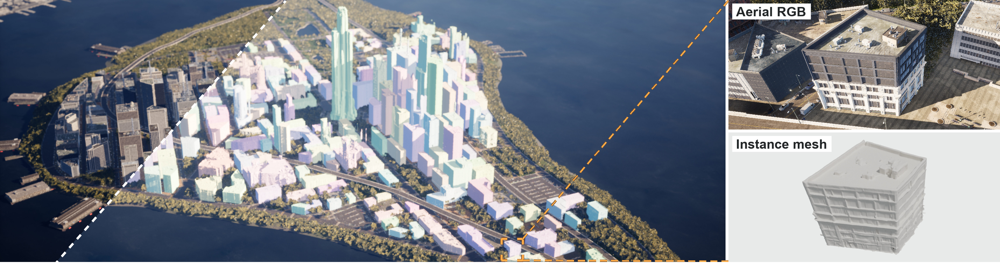
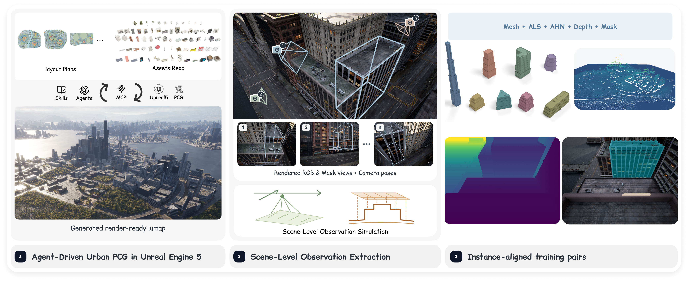
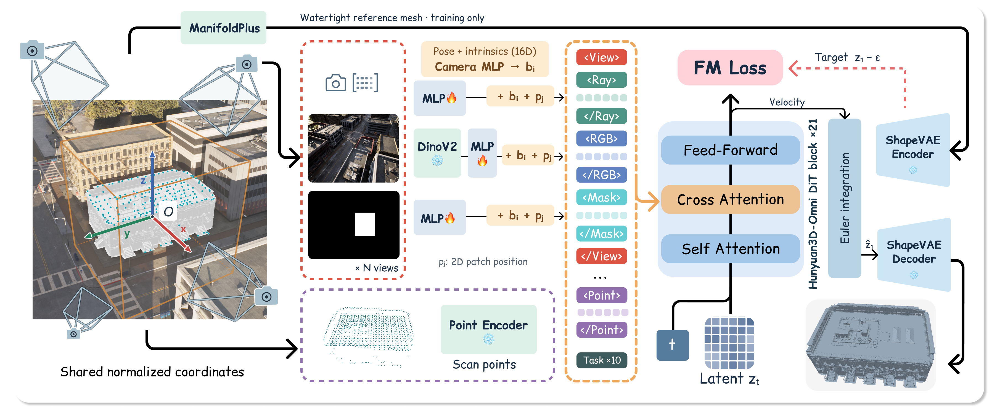

# CityGym

**A Citywide Benchmark for Generative Building Reconstruction from Partial Aerial Observations**



*Citywide reconstruction with BuildFromGen. The white dashed line separates the original scene (left) from the reconstruction (right). Insets show one building in an input view and its predicted mesh from the same camera.*

## Abstract

Citywide reconstruction supports urban planning and energy analysis by providing explicit roof and facade geometry at metric scale. However, some facades remain hidden by neighboring buildings, leaving their geometry underdetermined and complicating complete city reconstruction with measured surfaces. Existing datasets rarely pair citywide aerial imagery and laser scans with the detailed facade geometry needed to train and evaluate models that reconstruct surfaces hidden from both sensors. To approximate real urban surveys and evaluate geometry-conditioned reconstruction, we introduce a synthetic benchmark, CityGym, and a generative baseline, BuildFromGen. CityGym simulates overhead and oblique photography and independently samples airborne range measurements over four procedural cities in Unreal Engine 5, pairing 9,262 complete building meshes with 192,560 calibrated RGB views and laser returns. BuildFromGen uses uncropped multi-view RGB images and target-box masks, encoding calibrated patch rays and registered scan points in a shared normalized frame with reference-derived center and scale. With 32 views and the scan, BuildFromGen achieves a full-surface F1 of 88.93% at 0.5 m and a mean surface Chamfer distance of 0.235 m on the 596 held-out buildings in the main comparison.

## CityGym



A planning agent converts geographic information into soft layout constraints. Unreal Engine 5 generates streets and buildings from modular assets, then camera stations and independently sampled scan rays observe each building in its urban context. Building IDs link calibrated RGB views, instance masks, and registered laser returns to each building's complete reference mesh.

## BuildFromGen



BuildFromGen encodes aerial RGB images, target-box masks, calibrated patch rays, and registered scan points in a shared building frame. Grouped view tokens and scan features condition mesh generation, and the predicted mesh is transformed back to world coordinates.

## Code

Coming soon.

## Data

Coming soon.

## Citation

If you use CityGym or BuildFromGen in your research, please cite CityGym.

```bibtex
@misc{ma2026citygym,
  title  = {{CityGym}: A Citywide Benchmark for Generative Building Reconstruction from Partial Aerial Observations},
  author = {Ma, Yanwen and He, Lingfeng and Deng, Yichen and Zhang, Xuying and Guo, Yijing and Li, Haoran and Tan, Yumin},
  year   = {2026},
  url    = {https://github.com/Gelercatty/CityGym}
}
```

[Download CITATION.bib](CITATION.bib)
